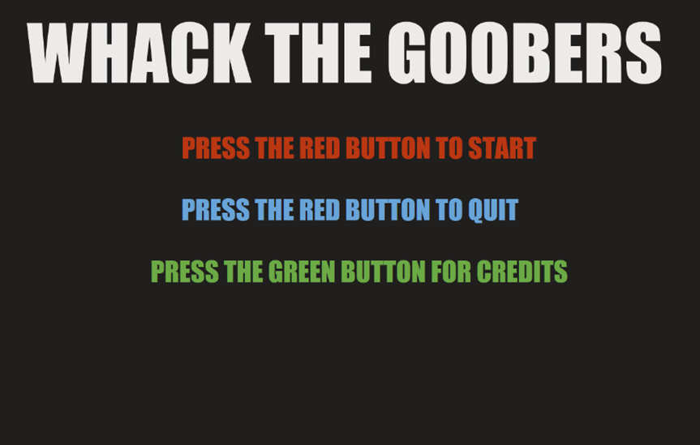
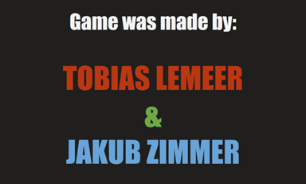
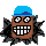
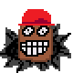
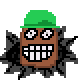
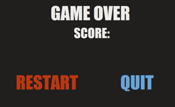

**Whack-The-Goobers**

**Made by: [@Dulla-han](https://github.com/Dulla-han), [@tobipbop](https://github.com/tobipbop)**

**Introduction**

Whack-a-mole is a classic arcade game first released in the 1970s.

**Gameplay**

The basic gameplay is simple. There are multiple holes (3 in our case) on a playing field. When game starts moles start to pop up from the holes one at a time in unpredictable patterns. The timer is set off after a mole appears, which stops when a mole is “whacked”. The faster the whack, the bigger the point amount is added to the score counter. The game ends after 30 seconds and the player with a higher score is the winner.

**The Game**

**Starting screen**

When a player first boots up the game, the start menu will appear. Three options will be available, _Start_, after which the game immediately begins, _Quit_, which will instantly exit the game, and _Credits_, this will display credits to creators while the button is pushed

_Controls_

_Start_ option – press the red button
_Quit_ - press the green button

 

_Starting screen_

_The Credits_

**Playing the Game**

After the player selects the _Play Game_ option, the moles will unpredictably start jumping out of the holes. There will be three holes, from which moles will pop up, each hole for one of the buttons. When a mole is visible, he can be whacked by pressing one of the buttons.

**Controls**

Left hole mole – press the red button
Middle hole mole - press the green button
Right hole mole - press the blue button

   

_The in-game moles_

 

_The whack hit effect_

**GameOver**

This screen will open automatically after the time reaches 0 seconds. It will showcase the player’s score count as well as two additional options: _Restart_ and _Quit_. Similarly to the _Starting Screen_ Play Again will start the game, resetting the score and time, and choosing Quit option will result in exiting the game.

**Controls**

_Restart_  – press the red button

_Quit_ - press the blue button
 

_GameOver screen_

